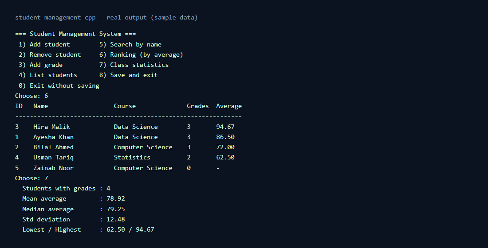

# Student Management System (C++)

A console application for managing student records and grades, written in modern C++17 with a clean
object-oriented structure and dependency-free unit tests.

## Features
- Add / remove students (unique, never-reused IDs)
- Record grades (validated to 0-100)
- List, search (case-insensitive) and rank students by average grade
- Class statistics: mean, median, standard deviation, min, max
- Save to / load from a CSV file (`students.csv`), with malformed files rejected safely

## Screenshot


_Real output of the application running on `data/sample_students.csv` (terminal text rendered as an image)._

## Project structure
```
src/
  student.hpp           Student + Stats data types
  student_manager.hpp   StudentManager class (all business logic)
  student_manager.cpp
  main.cpp              Menu-driven console UI (input validation)
tests/
  test_manager.cpp      Unit tests (no external framework)
data/
  sample_students.csv   Example data - copy to ./students.csv to try it
```
Logic and UI are separate: `StudentManager` knows nothing about `std::cin`/`std::cout`, which is what makes it testable.

## Build and run

**Linux / macOS / MinGW (make):**
```bash
make            # builds ./student_manager
make test       # builds and runs the tests
./student_manager
```

**CMake (any platform):**
```bash
cmake -S . -B build
cmake --build build
ctest --test-dir build --output-on-failure
```

**Windows (MSVC, Developer Command Prompt):**
```bat
cl /EHsc /std:c++17 /W4 /Fe:student_manager.exe src\main.cpp src\student_manager.cpp
```

## CSV format
```
id,name,course,grades
1,Ayesha Khan,Data Science,88;92.5
```
Commas and semicolons inside names/courses are replaced by spaces when a student is added, so the file stays valid.

## What I practised
Classes and encapsulation, `std::vector`, `<algorithm>` (`stable_sort`, `remove_if`), file I/O, robust input handling,
basic statistics, and writing tests for logic that is separated from the UI.

## Possible next steps
- Edit existing student details
- Per-course statistics and grade distribution
- Replace CSV with SQLite
